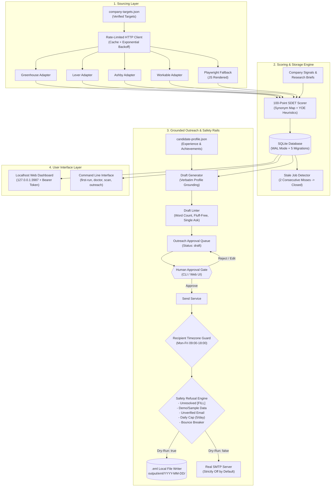

# JobHermes: Autonomous SDET Job-Search Copilot

[](https://github.com/yuvrajsingh2428/JobHermes/actions/workflows/ci.yml)


> **JobHermes** is an autonomous, precision-engineered job hunting copilot built exclusively for Software Development Engineers in Test (SDET) and QA Automation Engineers. It eliminates spray-and-pray job boards by scraping direct ATS career endpoints, scoring postings with a 100-point SDET taxonomy, managing human contacts, and generating fact-grounded cold outreach drafts protected by strict ethical guardrails and mandatory human approval gates.

---

## Mermaid System Architecture



---

## Why JobHermes for SDETs?

Traditional job hunting tools fail automation engineers because they cannot differentiate between manual functional testing and high-scale framework engineering. JobHermes solves this:

1. **Direct ATS Ingestion**: Bypasses recruiter spam on aggregators by pulling directly from official Greenhouse, Lever, Ashby, and Workable APIs.
2. **100-Point SDET Taxonomy**: Specifically weights automation tools (Playwright, Cypress, Selenium, Appium), API automation (REST Assured, Supertest), performance testing (k6, JMeter), and CI/CD pipelines. Manual testing roles are down-weighted or filtered out.
3. **Resilient Sighting & Stale-Job Detection**: Automatically detects when postings are removed from an ATS. Jobs absent for 2 consecutive scans are marked `closed` and removed from daily outreach queues. Network hiccups, timeouts, or 5xx errors never prematurely close a job.
4. **Candidate Grounding Guarantee**: Outreach drafts use profile numbers, years, and achievements *verbatim*. The system refuses to hallucinate fabricated purpose clauses like *"to accelerate testing feedback"* or *"to prevent defects before production deployment"*.
5. **Human-in-the-Loop & Recipient Timezone Protection**: Zero emails leave your machine autonomously. Every email requires explicit manual approval and is restricted to the recipient's local business hours (Mon-Fri 09:00-18:00).

---

## 5-Step Quickstart Setup

### Step 1: Clone and Install Dependencies

```bash
git clone https://github.com/yuvrajsingh2428/JobHermes.git
cd JobHermes
npm install
```

### Step 2: Configure Environment

```bash
cp .env.example .env
```

Review `.env`. Real email sending is strictly disabled by default (`SEND_REAL_EMAILS=false`). All outreach generates local RFC-822 `.eml` files in `output/eml/` for safe inspection.

### Step 3: Configure Candidate Profile & Run Diagnostics

Edit `config/candidate-profile.json` and replace the placeholder `[FILL]` markers with your real skills, years of experience, target locations, and verified achievements:

```bash
# Check onboarding status and missing items:
npm run first-run

# Run full system diagnostics:
npm run doctor
```

### Step 4: Explore the Demo Sandbox

Test the complete system safely using the isolated demo sandbox:

```bash
# Seed the demo sandbox database (data/demo.db):
npm run seed-demo

# Launch the dashboard in demo mode:
DEMO_MODE=true npm run dashboard
# Open http://127.0.0.1:3987 in your browser
```

### Step 5: Verify Live Targets & Run Daily Scan

```bash
# Verify active ATS slugs for target companies:
npm run verify-targets

# Run the live job discovery and scoring pipeline:
npm run scan

# Review matches and generate personalized outreach drafts:
npm run outreach generate <jobId> <contactId>
```

---

## Configuration Reference

### 1. Environment Variables (`.env`)

| Variable | Default | Purpose |
|---|---|---|
| `DATABASE_PATH` | `./data/jobhermes.db` | SQLite database file location |
| `DEMO_MODE` | `false` | When `true`, uses isolated sandbox `data/demo.db` |
| `SEND_REAL_EMAILS` | `false` | **Safety Switch**: Real sending. Keep `false` for `.eml` dry-runs |
| `DAILY_SEND_LIMIT` | `5` | Maximum emails allowed per calendar day |
| `MIN_SCORE_THRESHOLD` | `60` | Minimum score (out of 100) to qualify as an active match |
| `NEAR_MISS_MIN` | `40` | Minimum score for near-miss tier tracking (40-59) |
| `OPENAI_API_KEY` | `mock` | OpenAI API Key (`mock` enables offline mode) |
| `OPENAI_MODEL` | `gpt-4o` | Model used for research synthesis and summaries |
| `HUNTER_API_KEY` | *(optional)* | Hunter.io API key for contact discovery |
| `HUNTER_MONTHLY_QUOTA`| `25` | Hard limit on Hunter API calls stored in SQLite |
| `PORT` | `3987` | Local loopback port for the Express Web Dashboard |

### 2. Candidate Profile (`config/candidate-profile.json`)

```json
{
  "name": "Jane Doe",
  "email": "jane.doe@example.com",
  "phone": "+91-9876543210",
  "location": "Bangalore, India",
  "preferredLocations": ["Bangalore", "Delhi NCR", "Remote"],
  "experienceYears": 3,
  "skills": ["Playwright", "TypeScript", "REST Assured", "Java", "Docker", "CI/CD"],
  "achievements": [
    "Architected end-to-end Playwright automation framework reducing regression execution time by 60%",
    "Built API test suite using REST Assured covering 150+ backend microservice endpoints"
  ],
  "profile_reviewed": true
}
```

### 3. Company Targets (`config/company-targets.json`)

```json
[
  {
    "name": "HackerRank",
    "careers_url": "https://boards-api.greenhouse.io/v1/boards/hackerrank/jobs",
    "ats": "greenhouse",
    "slug": "hackerrank",
    "verified": true,
    "enabled": true
  }
]
```

---

## "First Week" Operational Guide

A structured routine to maximize your interview conversion while maintaining zero spam risk:

- **Day 1: Setup & Diagnostic Baseline**
  - Run `npm run first-run` to identify unresolved profile markers.
  - Run `npm run doctor` to verify environment variables, database directories, and schema health.
- **Day 2: Target Customization & Verification**
  - Use `add-company <careers-url>` to ingest your target dream companies. The tool auto-detects Greenhouse, Lever, Ashby, or Workable slugs.
  - Run `npm run verify-targets` to confirm all endpoints return HTTP 200.
- **Day 3: Initial Scan & Recalibration**
  - Execute `npm run scan` to pull live openings across all verified targets.
  - Review the score distribution. If you notice near-misses (40-59), inspect the missing skills breakdown in the dashboard to identify resume gaps.
- **Day 4: Contact Import & Heuristic Mapping**
  - Import identified QA Leads and Engineering Managers using `npm run import-contacts contacts.csv`.
  - Infer corporate email patterns using `contacts infer <companyId>` to generate pattern-derived emails marked `guessed`.
- **Day 5: Draft Generation & Profile Grounding Audit**
  - Generate grounded drafts: `npm run outreach generate <jobId> <contactId>`.
  - Review Variant A (proof point focus), Variant B (role-targeted focus), and LinkedIn DMs. Check that candidate sentences quote your profile verbatim.
- **Day 6: Dry-Run Send & .EML Audit**
  - Approve drafts via `npm run outreach approve <id>` or through the Web Dashboard.
  - Trigger dry-run sends (`npm run outreach send <id>`). Verify that generated `.eml` files in `output/eml/` look professional in your mail client.
  - Verify that the send-window blocks outside of recipient business hours (Mon-Fri 09:00-18:00).
- **Day 7: Follow-up Review & Automation**
  - Run `npm run outreach followups` to inspect sent emails older than 6 days with no reply.
  - Launch the web dashboard (`npm run dashboard`) to monitor funnel analytics.

---

## Safety, Ethics & Anti-Spam Guardrails

JobHermes is engineered to protect both the job seeker's reputation and the recipient's inbox.

### 1. Mandatory Human Approval Gate
Zero emails can be sent without explicit manual approval. Every draft is created with status `draft`. The sending service strictly refuses any outreach record unless transitioned to `approved` by the user.

### 2. Recipient Timezone-Aware Sending Window
Outreach is permitted only during business hours: **Monday through Friday, 09:00 to 18:00**, evaluated strictly in the recipient's local timezone (e.g., `Asia/Kolkata`, `America/New_York`, `Europe/London`). Weekend sends and late-night emails are blocked across both dry-run and real modes.

### 3. Anti-Hallucination Grounding Guarantee
- **Verbatim Profile Facts**: Candidate sentences are constructed verbatim from `config/candidate-profile.json`. The engine never invents fake metrics or purpose clauses.
- **Grounded Company Claims**: Factual statements regarding company expansion, funding, or hiring must strictly originate from stored research briefs or signals with verified URLs.

### 4. Volume Caps & Circuit Breakers
- **Daily Volume Cap**: Enforces a strict maximum of 5 emails per calendar day to ensure high-intent, thoughtful outreach.
- **Max 2 Emails per Contact**: The automated follow-up engine allows exactly one gentle follow-up after 6 business days. Once a contact replies or requests suppression, outreach immediately terminates.
- **Bounce Circuit Breaker**: If historical bounce rates exceed 10%, the sending queue halts automatically.

### 5. Safe Defaults & Refusal Engine
The engine refuses real-mode execution if:
- Candidate profile contains unresolved `[FILL]` markers.
- Contact email status is unverified or marked as demo/sample.
- Recipient is on the suppression list.
- Real mode switch (`SEND_REAL_EMAILS`) is `false`.

---

## Testing Strategy

JobHermes uses a 5-tier testing architecture guaranteeing 100% offline determinism and zero network calls during automated test runs.

```
tests/
├── unit/               # 82 unit tests
│   ├── scorer.test.ts          # 100-pt SDET scoring, YOE sweet spot, resilient stale job misses
│   ├── outreach.test.ts        # Grounding, fluff-free linter, real-mode refusal, follow-ups
│   ├── contacts.test.ts        # Persona targeting, pattern inferrer, timezone send-window
│   ├── fill-guard.test.ts      # [FILL] placeholder refusal guards
│   ├── parsers.test.ts         # Regex salary & YOE extractors
│   └── add-company.test.ts     # ATS detection & slug validation
├── contract/           # 8 contract tests
│   └── sources.test.ts         # Offline fixture tests for Greenhouse, Lever, Ashby, Workable, Playwright
├── api/                # 20 REST API tests
│   └── dashboard.test.ts       # Express endpoints, token auth, status transitions, doctor diagnostics
└── e2e/                # 4 Playwright browser tests
    └── dashboard-e2e.test.ts   # UI draft approval, dry-run fake clock send, CSV import, job filters
```

### Running Test Suites

```bash
# Run all 110 tests across all 9 suites:
npm test

# Run isolated test tiers:
npm run test:unit
npm run test:contract
npm run test:api
npm run test:e2e

# Generate v8 code coverage report:
npm run test:coverage

# Run linting and typechecking:
npm run lint
npm run typecheck
```

---

## Key Architectural Decisions

1. **SQLite with WAL Mode over Cloud Database**:
   - *Rationale*: A job search is private, local, and single-user. SQLite requires zero cloud credentials, stores all data on the user's local machine, and achieves microsecond latencies using Write-Ahead Logging (`journal_mode = WAL`).
2. **Deterministic Offline Contract Tests over Live API Mocking**:
   - *Rationale*: Scraping live ATS APIs during CI leads to flaky builds, rate-limiting, and dependency on external network health. Contract tests use recorded HTML/JSON payloads (`tests/fixtures/`) to verify schema stability offline.
3. **Local `.eml` Staging over Direct SMTP Dispatch**:
   - *Rationale*: Rendering outgoing emails as standard RFC-822 `.eml` files allows the user to inspect headers, HTML structure, and recipient fields in standard desktop mail clients before committing to real sends.
4. **Verbatim Grounding over Unconstrained LLM Generation**:
   - *Rationale*: Unconstrained LLMs frequently hallucinate metrics, titles, and purpose clauses. JobHermes enforces strict template constraints where candidate experience and achievements are injected verbatim.

---

## Sample Outreach Drafts

All generated drafts adhere to strict formatting: 80–120 words, subject under 8 words, zero generic fluff phrases, one concrete proof point, and one low-friction ask.

### [DEMO OUTPUT - SAMPLE GENERATED DRAFT: VARIANT A]

```
Subject: SDET test automation at HackerRank

Hi Priya,

I noticed the SDET role at HackerRank. Over the past 2 years, I built automated test frameworks with Playwright and REST Assured.

In my recent role, I architected end-to-end Playwright automation framework reducing regression execution time by 60%. Additionally, I built API test suite using REST Assured covering 150+ backend microservice endpoints.

Given HackerRank's focus on scalable evaluation platforms, would you be open to a brief 10-minute conversation next week?

Best regards,
Candidate

P.S. If you're not the right person, please feel free to ignore and I won't follow up.
```

*Word count: 104 words | Subject: 6 words | Lint: PASS*

### [DEMO OUTPUT - SAMPLE GENERATED DRAFT: VARIANT B]

```
Subject: Quick question regarding HackerRank SDET

Hi Priya,

I am writing regarding the SDET opening on HackerRank's engineering team. With 2 years specializing in test automation, I focus on building reliable CI test pipelines.

Recently, I architected end-to-end Playwright automation framework reducing regression execution time by 60% and built API test suite using REST Assured covering 150+ backend microservice endpoints.

Would you be open to connecting for 10 minutes next Tuesday to discuss how this aligns with your team's quality initiatives?

Best regards,
Candidate

P.S. If you prefer not to connect, let me know and I will not follow up.
```

*Word count: 97 words | Subject: 5 words | Lint: PASS*

### [DEMO OUTPUT - SAMPLE GENERATED DRAFT: LINKEDIN REFERRAL DM]

```
Hi Priya, I saw the SDET role at HackerRank and wanted to reach out. Over the past 2 years, I have focused on Playwright and API test automation (reducing regression runs by 60%). Would you be open to reviewing my resume for an internal referral? Happy to share details. Thanks!
```

*Word count: 54 words | Format: Single-paragraph connection note*

---

## CLI Command Summary

| Command | Action |
|---|---|
| `npm run first-run` | Comprehensive onboarding diagnostic checking profile and targets |
| `npm run doctor` | Validates environment, API keys, database, and safety settings |
| `npm run verify-targets` | Verifies active ATS endpoints in `company-targets.json` |
| `npm run add-company <url>` | Detects ATS, extracts slug, verifies live, and adds to targets |
| `npm run scan` | Scrapes all verified targets, scores postings, and detects stale jobs |
| `npm run rescore` | Recalibrates scores for all jobs upon signal or profile changes |
| `npm run import-contacts <csv>` | Imports contacts with persona mapping and timezone defaults |
| `npm run contacts list` | Lists all human contacts with email verification status |
| `npm run outreach generate <jId> <cId>` | Generates grounded Variant A, Variant B, and LinkedIn DMs |
| `npm run outreach approve <id>` | Human approval gate allowing draft to be sent |
| `npm run outreach send <id>` | Dispatches outreach (generates `.eml` in dry-run mode) |
| `npm run outreach followups` | Generates 6-day follow-up drafts for unanswered emails |
| `npm run dashboard` | Starts the local dark-mode Express Web Dashboard (`127.0.0.1:3987`) |

---

## License

ISC License. Copyright (c) 2026 Yuvraj Singh.
Built for software engineers seeking high-leverage, ethical, and autonomous career acceleration.
